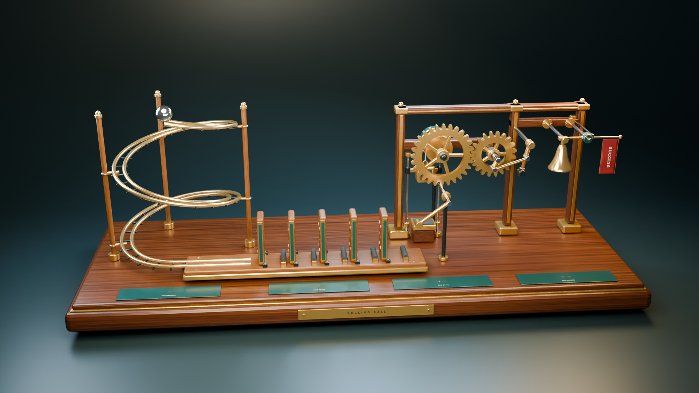

# Rolling Ball

### A study in consequence

A 25-second 3D film about one continuous mechanical chain reaction: polished steel, walnut, champagne brass, and a miniature **SUCCESS** flag. A moving camera follows the action through the complete machine, accompanied by synchronized mechanical sound.

[](film/Rolling-Ball.mp4)

**[Watch or download the film](film/Rolling-Ball.mp4)** · **[Download the editable Blender scene](scene/Rolling-Ball.blend)** · **[Read the mechanical design](docs/MECHANICS.md)**

## Film

| Specification | Delivery |
| --- | --- |
| Duration | 25.000 seconds |
| Resolution | 1920 × 1080 |
| Frame rate | 24 fps; 600 frames |
| Video | H.264 MP4, `yuv420p`, fast-start |
| Sound | Stereo AAC, 48 kHz; original procedural Foley |
| Source | Editable Blender scene, procedural scene builder, numerical simulation |
| Presentation | Standalone film with one continuous camera move |

## The chain reaction

1. A steel marble rolls down a two-turn brass spiral and along its continuous exit track.
2. Its impact topples **five** walnut dominoes in succession.
3. The fifth domino pushes a trip lever. A common shaft withdraws the sear supporting a counterweight.
4. The descending counterweight unwinds a cord drum and rotates two meshing brass gears.
5. An eccentric crank, connecting rod, and rocker move a small hammer into a suspended bell.
6. The swinging bell's yoke tab lifts a pawl, releasing the spring-loaded **SUCCESS** flag.

The machine uses a deterministic **reduced-order mechanical model**: constrained rolling, hinged dominoes, geometric contact, impulses, a taut cord, ideal gear ratios, a rigid linkage, and damped spring/pendulum motion. Blender plays the solved trajectories. There are no independent time triggers that advance the machine to its next stage. This is a purpose-built mechanism simulation, rather than a general rigid-body solver.

### Solved event times

Times below are film time and come directly from [the simulation data](data/simulation.json).

| Event | Time |
| --- | ---: |
| Marble begins rolling | 0.000 s |
| Marble strikes domino 1 | 9.999 s |
| Domino 2 begins falling | 10.222 s |
| Domino 3 begins falling | 10.584 s |
| Domino 4 begins falling | 10.940 s |
| Domino 5 begins falling | 11.258 s |
| Sear clears; counterweight and gears start | 11.709 s |
| Hammer strikes bell | 16.686 s |
| Bell tab releases flag pawl | 16.960 s |
| Flag settles upright | 17.889 s |
| Counterweight reaches its stop | 19.911 s |

The whole machine uses one **1.778568× slow-motion factor**, calibrated from the marble's travel. The final seconds allow the mechanism to settle and the camera to reveal the completed machine.

## Verification

[Mechanical verification](data/mechanical_verification.json) records **18 passing checks**, including real contact locations, continuity, fixed linkage lengths, cord payout, gear ratios, and the ordering of the complete sequence.

Six deliberate broken-chain experiments test causality: hold the marble, remove the middle domino, lock the counterweight, disconnect the driven gear, lock the hammer, or lock the bell. Each prevents the appropriate downstream stages; none can produce a successful flag release.

[Audio verification](data/audio-report.json) records the exact event cues, duration, and peak level. The encoder independently checks all 600 source frames, the final duration and stream formats, and a complete decode of the delivered MP4. Its report is saved beside the film as `film/Rolling-Ball.verification.json`.

## Reproduce the film

### Requirements

- **Blender 4.3.2** is the tested scene/render version. The supplied `.blend` includes the animation and packed fonts.
- **Python 3.10 or newer**, with the packages in [requirements.txt](requirements.txt), for Foley and optional standalone denoising. The mechanical simulation and tests use Python's standard library.
- **FFmpeg and FFprobe** with H.264 and AAC support.

Run from the repository root:

```bash
python -m pip install -r requirements.txt

# Solve the mechanics and verify the complete chain.
python src/simulate.py --output data/simulation.json
python -m unittest discover -s tests -v

# Build the editable scene and bake its solved trajectories and camera move.
blender -b --python src/build_scene.py -- \
  --simulation data/simulation.json \
  --output scene/Rolling-Ball.blend

# Render the complete 600-frame film with Cycles.
# --denoise requires a Blender build with Open Image Denoise support.
blender -b scene/Rolling-Ball.blend -t 8 --python src/render_frames.py -- \
  --start 1 --end 600 --output build/frames \
  --width 1920 --height 1080 --samples 32 --denoise

# Create synchronized mechanical sound, then encode and verify the MP4.
python src/audio.py --simulation data/simulation.json --output build/foley.wav
python src/encode.py --frames 'build/frames/frame_%04d.png' \
  --audio build/foley.wav --output film/Rolling-Ball.mp4
```

For a resumable render, add `--skip-existing`. `render_frames.py` also supports disjoint frame ranges, so separate Blender processes can render different chunks. Keep the same scene, resolution, and sample settings for every chunk.

If the installed Blender build lacks its denoiser, omit `--denoise` and use a separately installed official Intel Open Image Denoise shared library:

```bash
python src/denoise.py --input 'build/frames/frame_*.png' \
  --output build/clean --library /path/to/libOpenImageDenoise.so --threads 4

python src/encode.py --frames 'build/clean/frame_%04d.png' \
  --audio build/foley.wav --output film/Rolling-Ball.mp4
```

The optional standalone denoiser processes complete frames independently. It does not interpolate motion. Third-party binaries are not included in this repository.

## Files

| Path | Purpose |
| --- | --- |
| `film/Rolling-Ball.mp4` | Viewable final animation |
| `film/Poster.jpg` | Film poster / preview still |
| `scene/Rolling-Ball.blend` | Editable scene and baked animation |
| `src/simulate.py` | Contact-driven mechanical model and event export |
| `src/build_scene.py` | Geometry, materials, lighting, and camera construction |
| `src/render_frames.py` | Exact frame-range renderer with per-frame checksums |
| `src/audio.py` | Original, event-synchronized stereo Foley |
| `src/encode.py` | MP4 assembly and encoded-stream verification |
| `src/denoise.py` | Optional standalone OIDN processing |
| `tests/test_causality.py` | Geometric, sequence, and broken-chain checks |
| `data/` | Solved animation samples, event times, camera path, and reports |
| `docs/MECHANICS.md` | Model assumptions, constraints, and validation details |

All machine geometry, material shading, animation, and sound are generated from the included source. No external models, textures, stock sound, music, or network services are needed to reproduce the film.
